# CYSE 425 — Lab 6: DJI Tello Drone Exploration

  

## Project Summary

Hands-on DJI Tello lab using Python and DJITelloPy in Antigravity IDE on macOS, and Wireshark inside an Ubuntu VM with a USB Wi-Fi adapter configured for monitor mode. The exercise covers drone connectivity, flight-control commands, and 802.11 wireless traffic analysis. This is a classroom investigation; the assignment explicitly excludes password-related tasks.

**Original lab instructions:** [Exercise Steps (DOCX)](docs/Drone_Exploration_Lab_Exercise_Steps.docx) · **Upstream library:** [DJITelloPy](https://github.com/damiafuentes/DJITelloPy)

## At a Glance

| Item | Details |
|---|---|
| Drone | DJI/Ryze Tello |
| Wi-Fi SSID | TELLO-93FA07 |
| Drone BSSID | 34:d2:62:93:fa:07 |
| Wi-Fi channel | 5, 2432 MHz, 20 MHz, unsecured |
| Network | Tello gateway 192.168.10.1; Mac 192.168.10.2 |
| Host | macOS, Antigravity IDE, Python 3.12.3, DJITelloPy |
| Capture VM | Ubuntu, MediaTek USB Wi-Fi adapter, Wireshark |
| Monitor interface | wlx00c0cab7b17b |
| Evidence | 16 screenshots grouped into Tasks 1–6; four PCAPNG capture experiments documented as Tasks 7–10 |

## Assessment Workflow

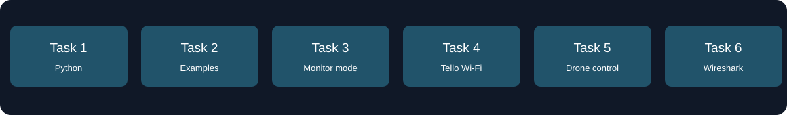

## Evidence Screenshots

All subnumbered screenshots appear under their parent task, rather than becoming separate tasks.

### Task 1 — Python setup

Installed DJITelloPy under Python 3.12.3 in the Mac's Antigravity terminal.

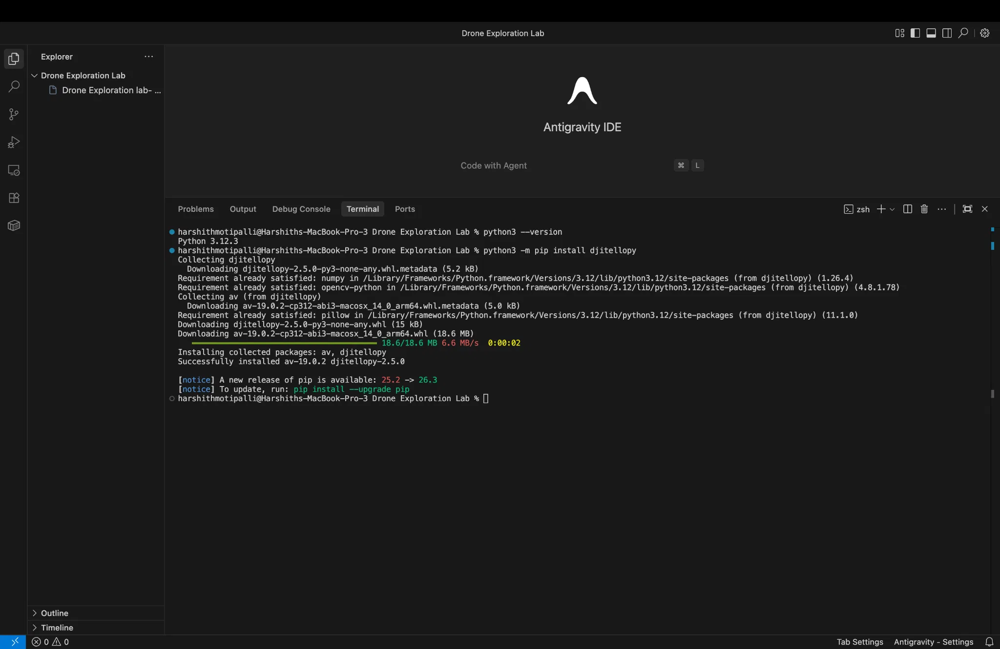

### Task 2 — Source examples

Cloned the upstream DJITelloPy project and inspected examples, including simple.py, take-picture.py, and record-video.py.

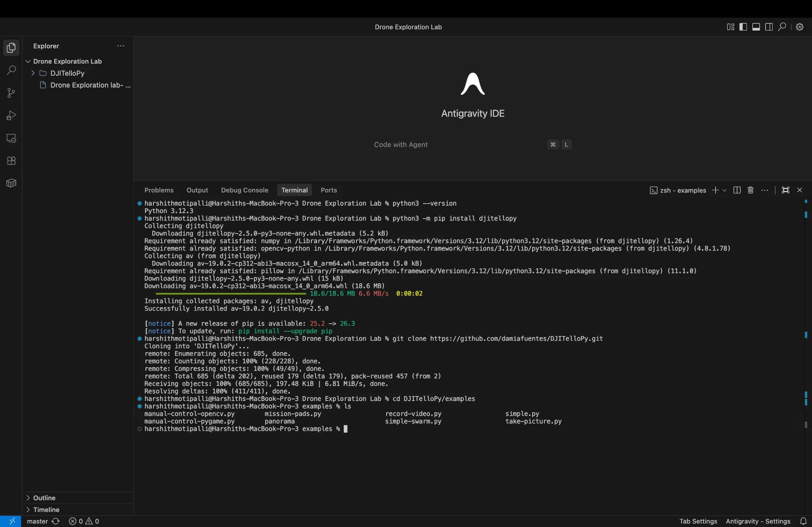

### Task 3 — Ubuntu monitor-mode setup

Inspected VM interfaces and USB hardware, detected a MediaTek USB Wi-Fi adapter, enabled monitor mode, and verified that Wireshark captured IEEE 802.11 traffic.

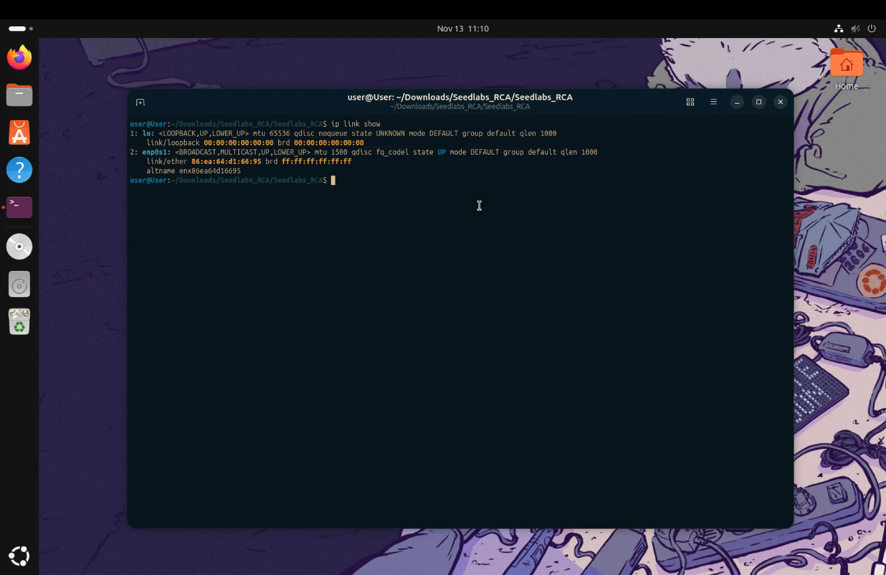

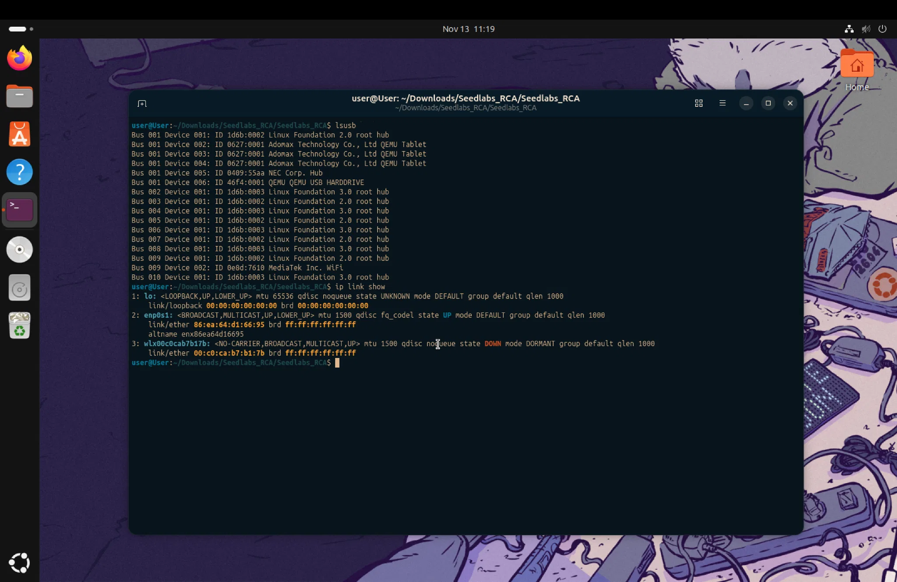

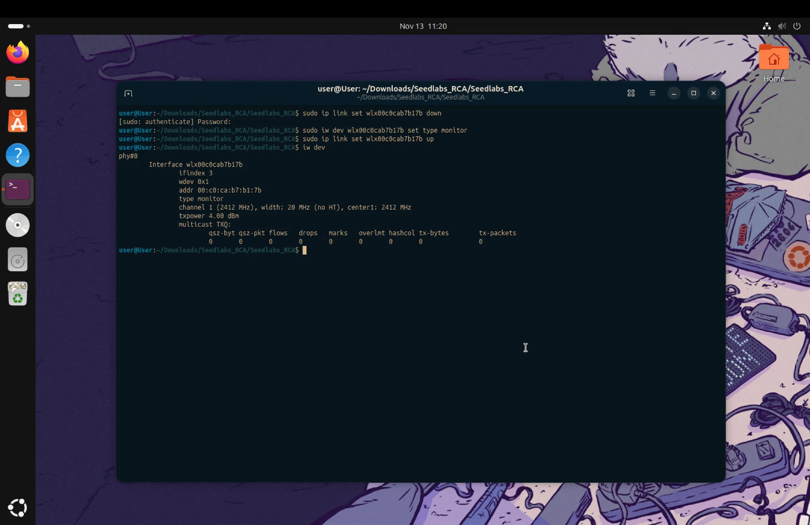

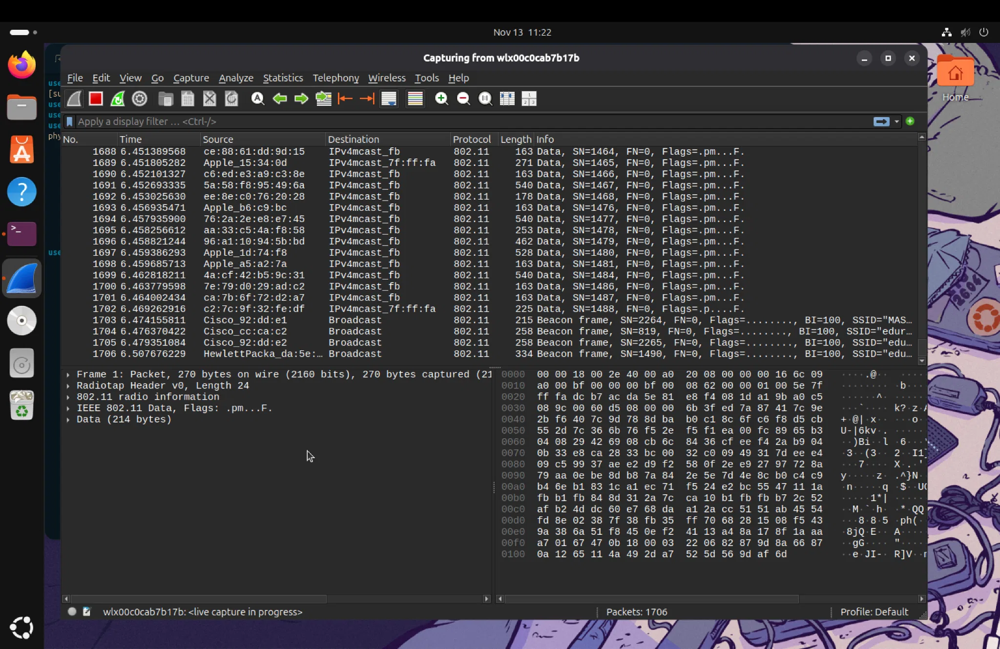

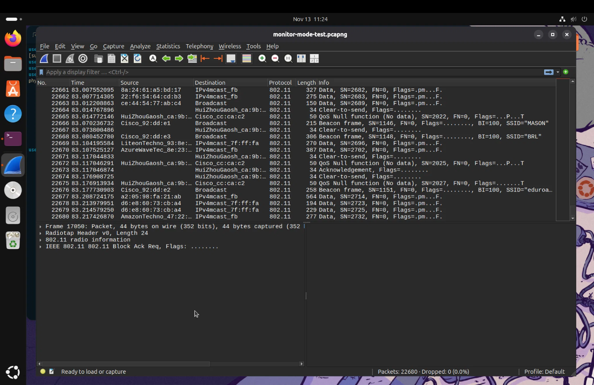

### Task 4 — Drone connection and channel alignment

Connected to the Tello Wi-Fi network on macOS, verified channel 5, tuned the USB capture interface, and observed Tello-related Wi-Fi frames. The drone is pictured in the lab.

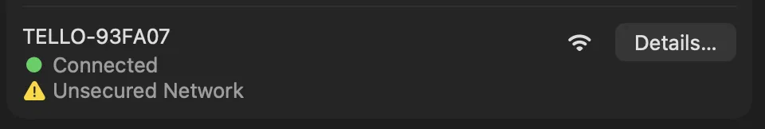

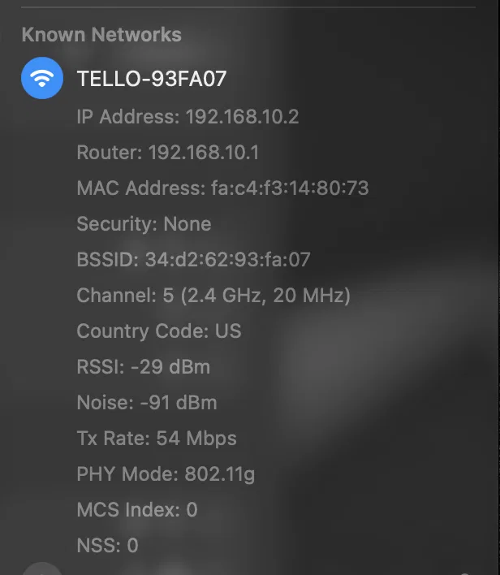

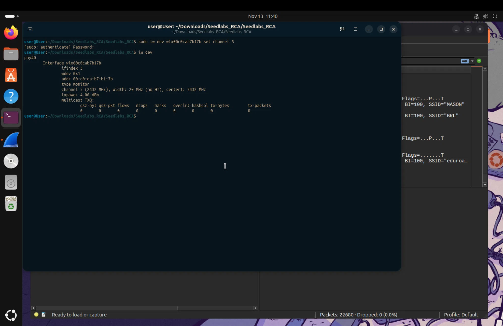

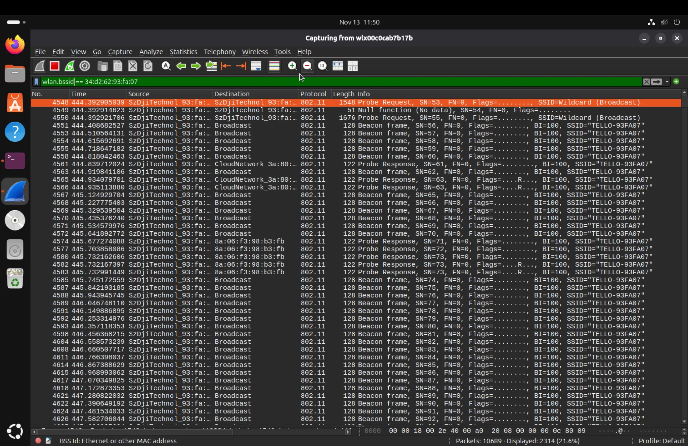

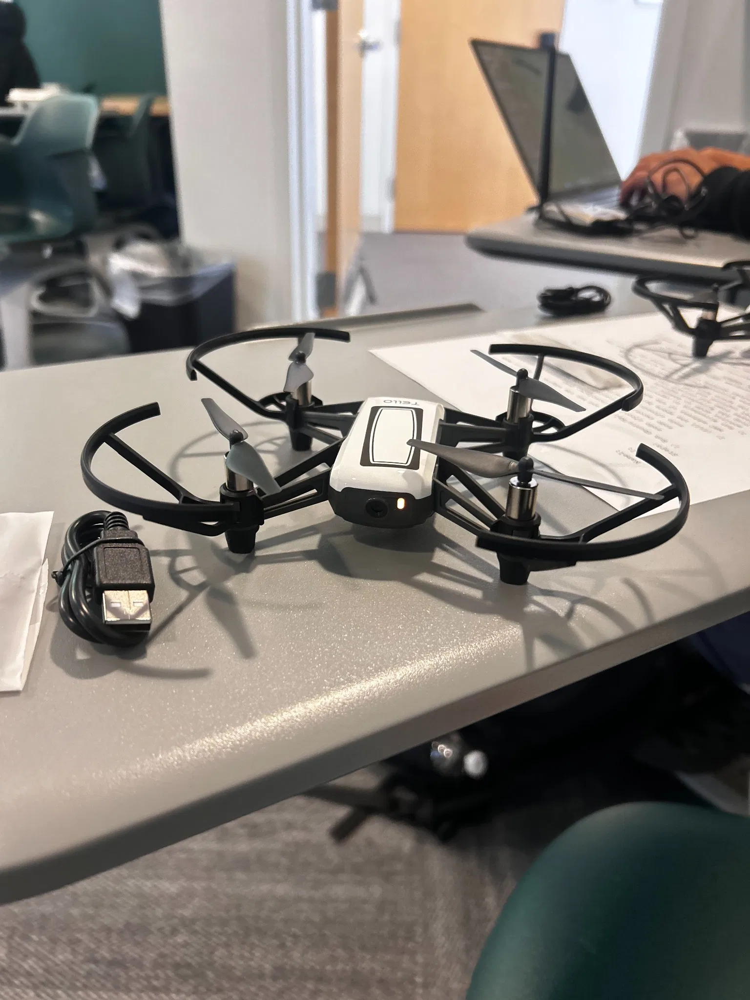

### Task 5 — Control sequence

Executed the DJITelloPy simple.py example; the terminal reports successful SDK responses for command, takeoff, left 100, clockwise 90, forward 100, and land.

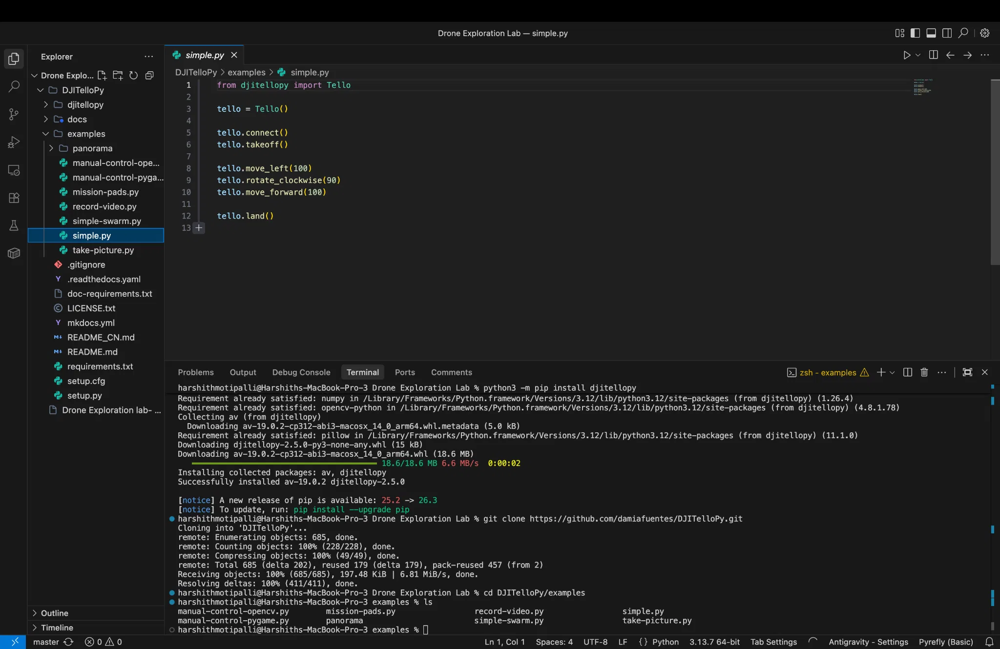

### Task 6 — Wireshark traffic analysis

Filtered beacon frames and the drone BSSID; observed repeated Tello beacon and probe-response frames.

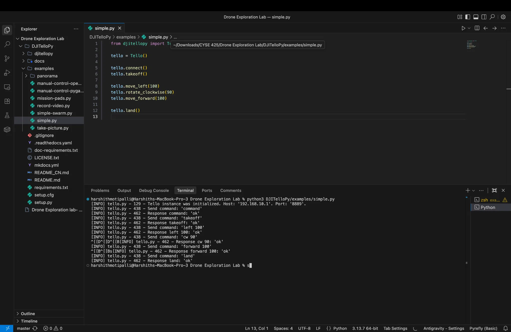

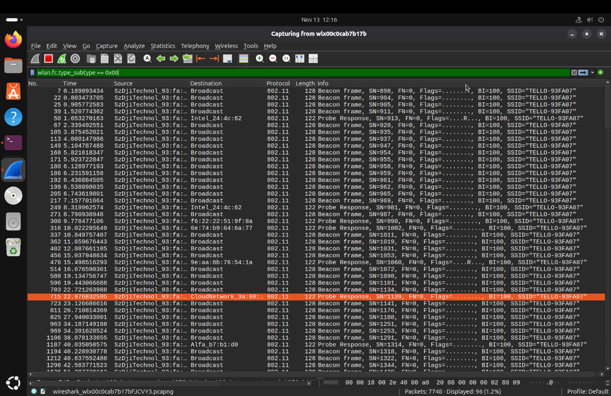

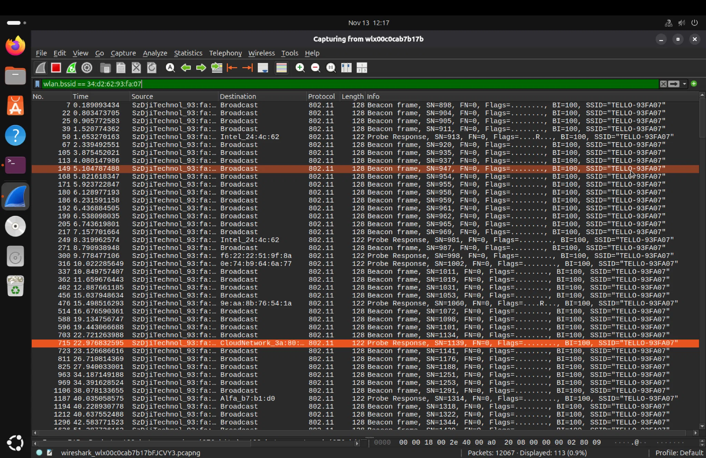

## Wireshark Capture Experiments — Tasks 7–10

The following four PCAPNG files were supplied after the screenshots. They are kept as **four additional parent tasks**, numbered sequentially after Task 6. These are original Wireshark capture recordings, rather than screenshots. The files have been inspected as PCAPNG with 802.11 radio metadata; their names identify the intended experiment, but a capture alone does not establish successful creation of an image or video.

| Task | Experiment | Original capture file | Captured packets | Approx. file size |
|---|---|---|---:|---:|
| 7 | Experiment 1 — Simple | `Experiment1_Simple.pcapng` | 19,306 | 1.98 MB |
| 8 | Experiment 2 — Take Control | `Experiment2_TakeControl.pcapng` | 3,711 | 0.41 MB |
| 9 | Experiment 3 — Take Picture | `Experiment3_TakePicture.pcapng` | 280,341 | 83.27 MB |
| 10 | Experiment 4 — Take Video | `Experiment4_TakeVideo.pcapng` | 893 | 0.10 MB |

### Task 7 — Experiment 1: Simple Drone Control Capture

**Source file:** `Experiment1_Simple.pcapng`

Wireshark captured **19,306 packets** during the experiment labeled Simple. The PCAPNG includes IEEE 802.11 beacon, probe-request, probe-response, control, and data frames. This capture corresponds to the Python `simple.py` control sequence documented in Task 5. The screenshot there records acknowledged drone SDK commands.

### Task 8 — Experiment 2: Manual / Take Control Capture

**Source file:** `Experiment2_TakeControl.pcapng`

The second experiment contains **3,711 captured packets**. It includes management, control, and data traffic consistent with a wireless capture session. Its supplied name indicates the Take Control/manual-control experiment, but the capture data alone does not prove a particular joystick or control interaction.

### Task 9 — Experiment 3: Take Picture Capture

**Source file:** `Experiment3_TakePicture.pcapng`

The third capture contains **280,341 packets** and is the largest of the four at approximately **83.27 MB**. It contains substantial IEEE 802.11 data traffic and includes frames associated with the Tello BSSID `34:d2:62:93:fa:07`. Its large packet volume is consistent with sustained wireless activity, but it does **not** independently verify that a picture file was created or identify a successfully saved image.

### Task 10 — Experiment 4: Take Video Capture

**Source file:** `Experiment4_TakeVideo.pcapng`

The fourth capture contains **893 packets**. The recorded frames include beacon, probe, control, and a small quantity of data traffic. The experiment is labeled Take Video, but this capture does **not** independently establish a decoded video recording or saved video output.

**Capture availability:** These four original PCAPNG files were uploaded to the conversation and inspected for this documentation update. The capture binaries are **not yet hosted in this repository**, so the filenames above are descriptive rather than broken download links. The existing screenshots and original assignment are unchanged.

## Findings and Evidence

| Finding | Evidence | Interpretation |
|---|---|---|
| DJITelloPy installation | Task 1 | macOS Python dependencies installed |
| Example source available | Task 2 | Drone program examples identified |
| Monitor mode functioning | Task 3 | VM could capture raw 802.11 traffic |
| Drone Wi-Fi discovered | Task 4 | SSID, BSSID, gateway, and channel verified |
| Control commands acknowledged | Task 5 | SDK returned success for listed movements and landing |
| Drone management frames visible | Task 6 | Beacon and probe-response activity matched the drone BSSID |
| Simple, Take Control, Take Picture, Take Video captures | Tasks 7–10 | Four valid 802.11 PCAPNG datasets inspected |

## What This Project Demonstrates

- Control of a physical DJI Tello drone from a Mac using a Python SDK.
- Coordination between a macOS host and an Ubuntu virtual machine.
- Configuration and verification of USB Wi-Fi monitor mode.
- Packet inspection using Wireshark display filters, beacon frames, and BSSID.
- Evidence-based reporting that distinguishes executed programs from merely available examples.

## Scope and Limitations

The lab instructions also request manual control, taking a photo, and recording video, with individual Wireshark captures. Those program runs and saved outputs are not established by the 16 uploaded screenshots, so they are not claimed as completed. The screenshots verify a Tello command sequence and management-frame capture, not recovered photo or video contents. Four original PCAPNG files were subsequently provided and their packet counts were inspected; their binaries are not yet hosted here. No project-specific executable source was uploaded.

*All 16 evidence screenshots and the original exercise document are preserved in this repository.*
